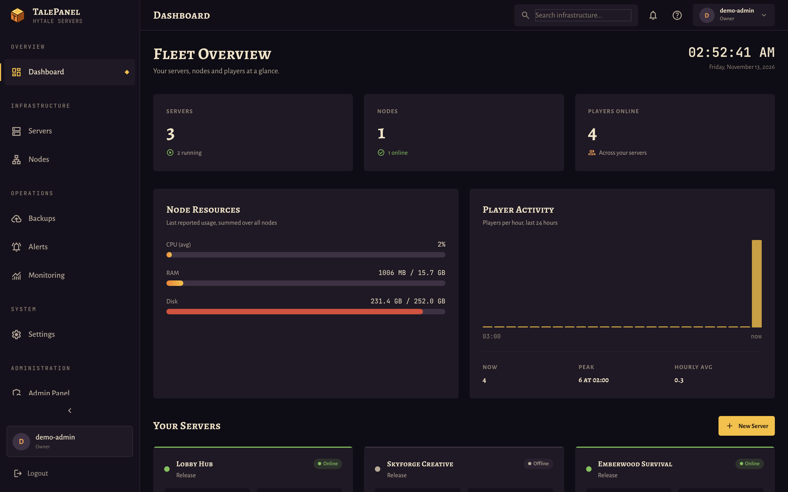
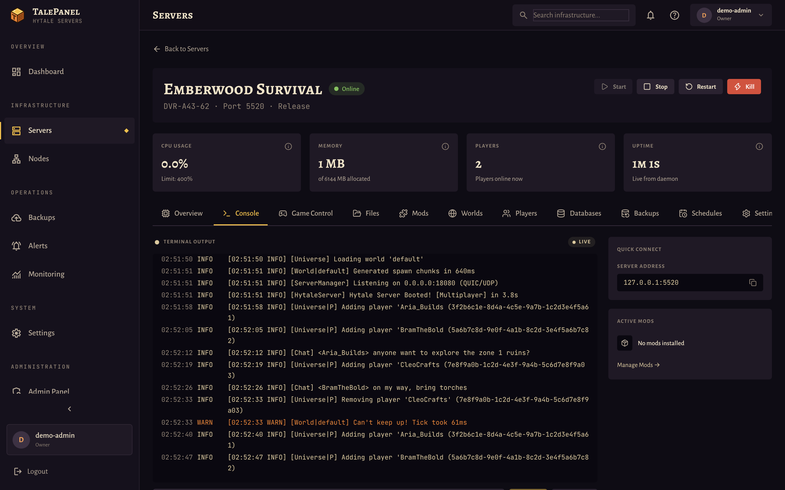
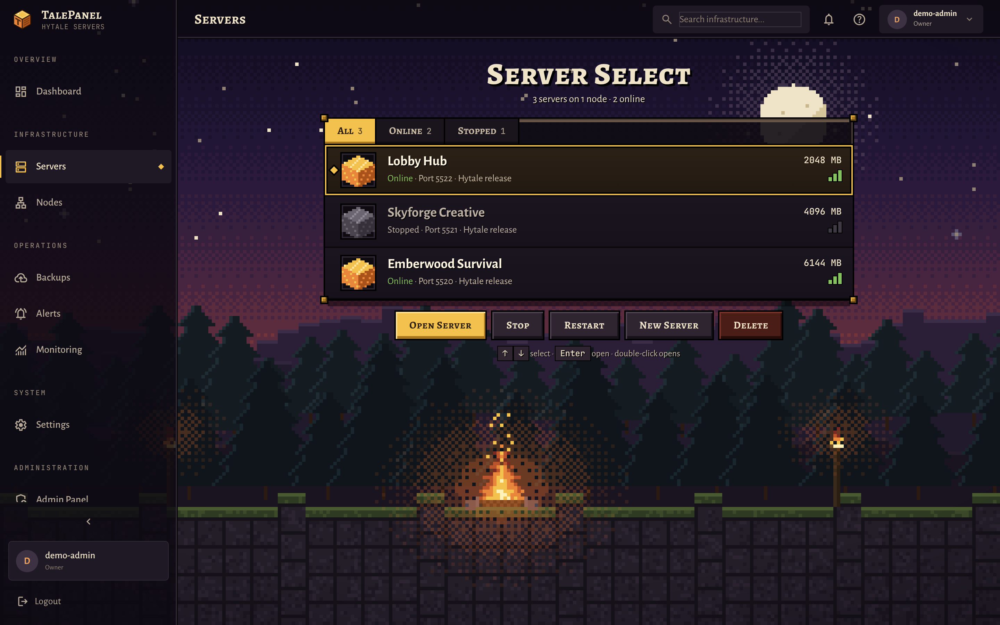
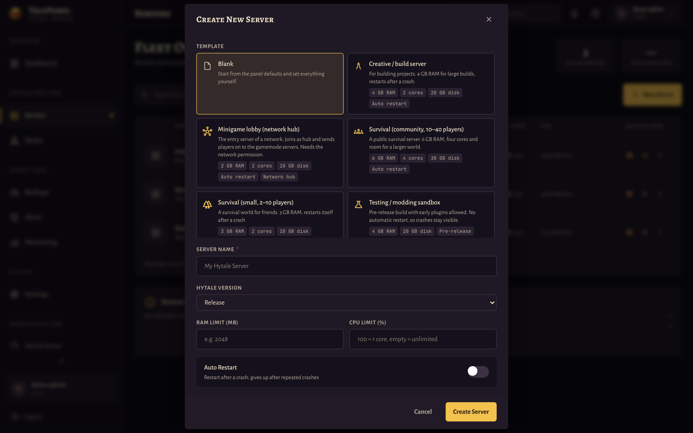

# TalePanel — open-source Hytale server panel

**The Hytale server panel that actually understands Hytale.** Self-hosted Hytale server management for one VPS or a whole network of nodes.

[](https://github.com/BitaceS/talepanel/releases)
[](https://github.com/BitaceS/talepanel/actions/workflows/ci.yml)
[](LICENSE)
[](https://github.com/BitaceS/talepanel/stargazers)
[](https://discord.gg/6N8WNrW5WJ)

**[Website](https://talepanel.com) · [Docs](https://talepanel.com/docs/) · [Install guide](https://talepanel.com/docs/start/install/) · [Roadmap](docs/ROADMAP.md) · [Discord](https://discord.gg/6N8WNrW5WJ)**
Built by [BitaceS](https://github.com/BitaceS) · AGPL-3.0 · free, forever

> If TalePanel is useful to you, a ⭐ on GitHub helps other Hytale server owners find it.

<p align="center">
  
  
</p>
<p align="center">
  
  
</p>

**Try it in five minutes, without a server:** [`examples/demo`](examples/demo/) runs the whole panel on your machine with simulated Hytale servers. All it needs is Docker: `docker compose -f examples/demo/compose.yml up -d --build`.

---

## What is TalePanel?

TalePanel is a free, open-source, self-hosted **Hytale server panel** and **Hytale server manager**. You use it to run and manage Hytale servers from your browser: start and stop servers, use the live console, and manage mods (CurseForge, Modtale or upload), worlds, players and backups. It works on a single VPS or across many nodes. Install takes one command and HTTPS is set up automatically. Accounts get 2FA and permissions per server, and every action is audit-logged.

It works as a Hytale hosting panel for communities and small hosters too: multi-node, per-server roles, no paid tier. Think of it as a Pterodactyl alternative built only for Hytale ([how they compare](https://talepanel.com/docs/reference/pterodactyl-vs-talepanel/)). Worlds, mods and players are real objects in the UI, not files in a generic file manager.

**Status:** actively developed. Latest release: [v0.18.0](https://github.com/BitaceS/talepanel/releases/tag/v0.18.0) (2026-11-26), see the [changelog](CHANGELOG.md). It runs against real Hytale servers. The list below is the honest split between what ships today and what is still roadmap — no marketing bullets that the code does not hold.

### At a glance

| | |
|---|---|
| **Install** | One command (`install.sh --quick`), automatic HTTPS via Let's Encrypt, no domain needed (`sslip.io`) |
| **Servers** | Create from templates, start / stop / restart / kill, live console (SSE), RAM + CPU limits, auto restart after crashes |
| **Automation** | Scheduled restarts (with in-game warning), Hytale updates in a maintenance window (backup first), console commands and broadcasts; scheduled backups; API keys with limited rights for scripts and bots ([example](examples/api/)) |
| **Hytale-native** | Launch flags, auth modes, exit codes, Release / Pre-release builds, Hytale account link (OAuth device flow) |
| **Content** | Worlds, file manager, mod upload + CurseForge and Modtale browsers, players (kick, ban, whitelist, op) |
| **Backups** | Scheduled, encrypted (ChaCha20-Poly1305), off-site via rclone (S3, B2, OneDrive, Google Drive, Dropbox, SFTP, WebDAV) |
| **Scale** | Multi-node with one-time enrollment tokens, mutual TLS between panel and nodes, network mod with `/play` handoff |
| **Security** | 2FA with recovery codes (can be required for admins), single sign-on via OpenID Connect, new-device sign-in emails, RBAC per server, audit log, rate limiting, optional admin IP allowlist, no default accounts |
| **Languages** | English and German (switch in the user menu) |
| **Alerts** | Discord, webhook and email |
| **Stack** | Go API, Rust daemon, Nuxt 3 web panel, PostgreSQL, Redis |

---

## Why TalePanel

A lot of Hytale panels are showing up right now. A game panel hands strangers a console, a file manager and a mod installer on your machine, so most of them will turn out to be the weakest link of the box they run on. TalePanel was built the other way around.

### Security is the default, not a setting

- **Nothing to forget after install.** No seed account, no default password. Every secret (JWT, TOTP key, DB/Redis passwords) is generated per install, and the admin account is the one you create during setup.
- **Logins that hold up.** bcrypt passwords, TOTP 2FA encrypted at rest (AES-256-GCM), short-lived access tokens kept in memory only, rotating refresh tokens, rate limiting on auth, and an audit log of who did what.
- **Permissions per server.** Owner / admin / moderator / user roles plus per-server membership, checked on every server route. A moderator on one server sees nothing of the others, and dangerous console commands (stop, op, give, ...) need the right role.
- **Built to survive hostile input.** Users can upload files, mods and archives, type console commands and paste URLs. All of it is treated as untrusted:
  - SQL is always parameterised.
  - Console input with control characters is rejected.
  - Every file operation is confined to the server's own directory and refuses symlinks planted there.
  - Archives are checked for zip-slip and size bombs.
  - Mod downloads only reach public HTTPS addresses, so no SSRF into your network or cloud metadata.
  - The panel ships a strict CSP and anti-clickjacking headers.
- **Daemon you can reason about.** The node agent is written in Rust. It only accepts requests carrying its node token, compared in constant time, and validates every path it is given against the server it belongs to.
- **Open about the gaps.** What is not done yet is listed in [`SECURITY.md`](SECURITY.md) instead of hidden. The main gap left is container-level isolation per server (servers already run under their own Linux user, with a system call filter and a network guard). Vulnerability reports get an answer within 48 hours.

### Install in one command, not one afternoon

- **One script for everything.** Panel, daemon or both. Docker gets installed if missing, secrets are generated, and HTTPS is set up automatically with Let's Encrypt.
- **No domain needed.** Without a domain the installer uses an `sslip.io` hostname with a real certificate: no self-signed warnings, no reverse-proxy tutorial.
- **Adding a node takes one token.** Create a one-time enrollment token in the panel, paste it into the daemon installer, and the node shows up online about 30 seconds later.
- **Updates migrate themselves.** Database migrations run on API start, and the installer has an `Upgrade` mode. There are no SQL files to apply by hand.

### Made for Hytale, not adapted to it

Worlds, mods, players and the Hytale account link are real objects in the UI, not files you edit by hand. The daemon knows Hytale's launch flags, auth modes and exit codes. Mods come from CurseForge, Modtale or from upload.

---

## Status — what works today

**Shipped and working against real Hytale servers:**

- **Servers** — create (blank or from a template: survival, community survival, creative, network lobby, modding sandbox, or your own), start, stop, restart, kill, resource limits, per-server member roles.
- **Schedules** — restarts (with an optional in-game warning), console commands and broadcasts on a cron schedule, run with the permissions of the user who saved them.
- **Live console + logs** — command input and log tail. Log lines, status changes and metrics (every 5 s) are pushed to the browser over Server-Sent Events (`GET /api/v1/servers/:id/stream`); commands still go out as plain POSTs. If the stream cannot connect (three failed attempts, e.g. a proxy that buffers responses) the page falls back to the old polling (logs ~1 s, metrics ~5 s, status 4–15 s); the console header shows **Live** or **Polling**.
- **Performance graphs** — CPU, memory and players online per server over 1 h, 6 h, 24 h or 7 days on the server's Overview tab (one sample per minute, kept 8 days).
- **Multi-node** — enroll additional daemon hosts with a one-shot token, servers get scheduled onto nodes.
- **Worlds** — list, switch and delete the worlds the Hytale server created. TalePanel does not generate worlds itself.
- **Files** — browse, edit, upload, download inside the server directory.
- **Config editor** — `config.json`, permissions, whitelist and bans as a form, with a Raw JSON view; invalid JSON is never saved.
- **Mods (upload-based)** — upload a mod file, it is installed, enabled/disabled and tracked per server. Mod files are detected by filename + SHA-256; where a metadata manifest exists (`plugin.yml`, `fabric.mod.json`) it is parsed. A Hytale-native manifest format does not exist publicly yet — when it does, TalePanel will read it.
- **CurseForge mod browser** — search and install mods from CurseForge. Needs only an API key (Admin → Integrations); the Hytale game ID is looked up automatically. Upload-based install keeps working without a key.
- **Modtale mod browser** — search [modtale.net](https://modtale.net) for plugins, data packs and art packs and install the newest release or a chosen version; switch versions later. No API key needed.
- **Backups** — create/restore/download/schedule a Zip snapshot of a server. The archive is written on the node; optionally the node also uploads it off-site with rclone to **OneDrive, Google Drive, Dropbox, S3-compatible storage (AWS, Wasabi, R2), Backblaze B2, SFTP or WebDAV/Nextcloud**, with upload status, retention and "keep local copy" per destination. Archives are encrypted (ChaCha20-Poly1305) on the node before they are written, under a panel-managed key.
- **Players** — list, kick, ban, whitelist.
- **Auth & security** — JWT + refresh, TOTP 2FA (AES-256-GCM at rest) with single-use recovery codes, RBAC (owner > admin > moderator > user), audit log, rate limiting, no seed account, no default password. Panel and nodes talk over mutual TLS with certificates the panel issues itself; nothing to configure. Certificates renew while running, and the owner can rotate the panel CA without downtime.
- **Install** — one script for panel or daemon, automatic Let's Encrypt TLS, works without a domain via `sslip.io`.

**Not there yet (roadmap, tracked publicly):**

- **Test coverage** — growing (Go unit + integration tests, Rust tests in the daemon, JUnit in the mod) but far from complete. Beta means beta.
- **Container-level isolation per server** — each server already runs under its own Linux user (v0.13) with a system call filter, a network guard and memory limits (v0.16), but shares the kernel and the process list with the other servers on the node. See [`SECURITY.md`](SECURITY.md).

---

## Install (self-hosted)

### Quick setup (beginners)

One Linux server (Ubuntu 22.04+, Debian 12 or Rocky/Alma 9, at least 2 CPU
cores and 6 GB RAM, ports 80, 443 and 5520 open). Run:

```bash
sudo bash <(curl -fsSL https://raw.githubusercontent.com/BitaceS/talepanel/main/scripts/install.sh) --quick
```

It asks no questions and takes a few minutes. At the end it prints a link
like `https://203-0-113-7.sslip.io/setup` and a one-time setup code like
`ABCD-EFGH-JKLM`. Open the link, enter the code, create your account and
your first Hytale server. Without `--quick` the same script shows a menu;
pick **Quick setup**.

### Separate panel and game servers

TalePanel is AGPL-3.0 self-hosted. Pick one server for the panel (1 CPU, 2 GB RAM is fine) and one or more servers for the daemon (the hosts that actually run Hytale).

### One script, any role

```bash
sudo bash <(curl -fsSL https://raw.githubusercontent.com/BitaceS/talepanel/main/scripts/install.sh)
```

A menu lets you pick: **Quick setup**, **Panel**, **Daemon**, **Both** (same
host, dev/home), **Upgrade**, or **Uninstall**. For unattended installs pass `--mode panel`
or `--mode daemon` plus the relevant flags — see `bash install.sh --help`.

**No domain?** Leave the domain prompt blank (or pass `--ip-only`) and the
installer auto-builds an `sslip.io` hostname from your server's public IP.
Let's Encrypt still issues a real TLS cert, so the panel opens over proper
HTTPS — no browser warnings, no self-signed workarounds.

The full operator reference (hardware sizing, DNS, firewall, supported distros, troubleshooting) lives in [`INSTALL.md`](INSTALL.md).

### Panel host (control plane)

Installs Docker if missing, clones into `/opt/talepanel`, generates every
secret via `openssl rand -hex 32`, creates the admin account you choose,
and starts the stack behind Caddy with automatic Let's Encrypt TLS.

### Daemon host (gameserver)

In the panel, go to **Nodes → Add Node** to get a one-shot enrollment token
(15-minute TTL, single-use). Then run `install.sh --mode daemon` on the
daemon host with `--panel-url` and `--enrollment-token`. The node appears
as `online` within ~30 seconds.

> **Offline / air-gapped install:** drop `HytaleServer.jar` and `Assets.zip`
> into `/srv/taledaemon/hytale-bin/` on the daemon host. New servers
> copy them locally instead of pulling from the Hytale CDN, which is
> IPv4-only.

---

## FAQ

**What is the best free Hytale server panel?**
TalePanel is a free and open-source (AGPL-3.0) panel made only for Hytale. You host it yourself. It covers multi-node setups, roles per server, 2FA, an audit log and automatic HTTPS. Most alternatives are either generic game panels with a Hytale add-on (Pterodactyl/Pelican eggs, AMP) or single-host Docker panels.

**How do I host a Hytale server on my own VPS?**
Run the one-line installer above on a Linux VPS (Ubuntu 22.04+, Debian 12+, Rocky/RHEL 9+) and choose **Both**. It installs Docker, sets up HTTPS, starts the panel, and you create your first server in the browser. Hytale needs Java 25, and the default game port is UDP 5520.

**Do I need a domain?**
No. Without a domain, the installer uses an `sslip.io` hostname based on your server's IP and still gets a valid Let's Encrypt certificate.

**Is TalePanel a Pterodactyl alternative for Hytale?**
Yes. Pterodactyl and Pelican run Hytale through a generic "egg". TalePanel instead knows Hytale's launch flags, auth modes, exit codes, worlds and mods, and it links a Hytale account so servers start authenticated.

**Can I run several Hytale servers or a whole network?**
Yes. You can enroll any number of daemon nodes. Each node runs many servers on ports from 5520 upward. The bundled network mod adds a hub with `/play <gamemode>` handoff between servers.

**Is it secure?**
Security is the main design goal. See [Why TalePanel](#why-talepanel) and [`SECURITY.md`](SECURITY.md) for what is covered and which gaps are still open.

**What does it cost?**
Nothing. TalePanel is AGPL-3.0 and stays free for everyone. There is no paid edition.

---

## Monorepo Structure

```
talepanel/
├── apps/
│   └── web/           Nuxt 3 web panel
├── services/
│   ├── api/           Go backend API
│   └── daemon/        Rust node daemon (TaleDaemon)
├── deploy/
│   ├── panel/         Production panel compose
│   └── daemon/        Production daemon compose
├── mods/              Hytale plugins (talepanel-network)
├── scripts/           install.sh and helpers
├── services/api/migrations/   PostgreSQL migrations
├── docker-compose.yml
├── .env.example
└── README.md
```

---

## Prerequisites

| Tool | Version | Check |
|---|---|---|
| Docker + Docker Compose | latest | `docker -v` |
| Node.js | 20+ | `node -v` |
| Go | 1.26+ | `go version` |
| Rust + Cargo | 1.79+ | `rustc --version` |

---

## Quick Start (Local Development)

### 1. Clone and configure

```bash
git clone https://github.com/BitaceS/talepanel.git
cd talepanel
cp .env.example .env
```

Edit `.env` — at minimum set:
```bash
JWT_SECRET=<generate: openssl rand -hex 32>
JWT_REFRESH_SECRET=<generate: openssl rand -hex 32>
```

### 2. Start infrastructure (PostgreSQL + Redis)

```bash
docker compose up -d postgres redis
```

Wait ~10 seconds for Postgres to initialize (runs migrations automatically).

### 3. Start the API

```bash
cd services/api
go mod download
go run cmd/server/main.go
```

API is now at `http://localhost:8080`.
Health check: `curl http://localhost:8080/api/v1/health`

### 4. Bootstrap the first owner

No seed account is shipped. Create the first owner once, using the API container's bundled CLI (requires step 2's Postgres to be up):

```bash
docker compose run --rm api tale-cli admin create \
  --email you@example.com --username you \
  --password 'Correct-Horse-Battery-4!' --non-interactive
```

The password must be at least 12 characters with one digit and one non-alphanumeric symbol.

### 5. Start the web panel

```bash
cd apps/web
npm install
npm run dev
```

Web panel: `http://localhost:3000`

### 6. Start the daemon (optional — for local node)

```bash
cd services/daemon
cp config.example.toml config.toml
# Edit config.toml: set api_url, node_id, node_token
cargo run
```

---

## Running with Docker Compose (all services)

```bash
# Build and run everything
docker compose up --build

# Just infrastructure + API
docker compose up -d postgres redis api

# Watch API logs
docker compose logs -f api
```

---

## API Reference

Base URL: `http://localhost:8080/api/v1`

### Authentication

```bash
# Register
curl -X POST http://localhost:8080/api/v1/auth/register \
  -H "Content-Type: application/json" \
  -d '{"email":"user@example.com","username":"myuser","password":"securepass123"}'

# Login (use the owner you bootstrapped via tale-cli — see "Creating the first admin" below)
curl -X POST http://localhost:8080/api/v1/auth/login \
  -H "Content-Type: application/json" \
  -c cookies.txt \
  -d '{"email":"you@example.com","password":"your-password"}'

# Use returned access_token in subsequent requests:
curl http://localhost:8080/api/v1/auth/me \
  -H "Authorization: Bearer <access_token>"
```

### Key Routes

| Method | Route | Description |
|---|---|---|
| POST | /auth/login | Login |
| POST | /auth/register | Register |
| POST | /auth/refresh | Refresh access token |
| POST | /auth/logout | Logout + revoke session |
| GET | /auth/me | Current user |
| GET | /servers | List servers |
| POST | /servers | Create server |
| GET | /servers/:id | Get server |
| POST | /servers/:id/start | Start server |
| POST | /servers/:id/stop | Stop server |
| POST | /servers/:id/restart | Restart server |
| POST | /servers/:id/kill | Kill process |
| GET | /nodes | List nodes (admin) |
| POST | /admin/nodes/enroll | Create one-shot daemon enrollment token (admin) |
| POST | /nodes/enroll | Redeem enrollment token (daemon) |
| GET | /health | Health check |
| GET | /health/ready | Readiness check |

---

## Environment Variables

See `.env.example` for the full list with descriptions.

**Required secrets (never commit these):**
- `JWT_SECRET` — JWT signing key, min 32 chars, generate with `openssl rand -hex 32`
- `JWT_REFRESH_SECRET` — Different secret for refresh tokens
- `POSTGRES_PASSWORD` — Database password
- `REDIS_PASSWORD` — Redis password

---

## Default Ports

| Service | Port | Notes |
|---|---|---|
| API (Go) | 8080 | REST API + live event stream (Server-Sent Events on the same port; a reverse proxy in front must not buffer `text/event-stream`) |
| Web Panel | 3000 | Nuxt 3 dev server |
| PostgreSQL | 5432 | Database |
| Redis | 6379 | Cache + queue |
| TaleDaemon | 8444 | Node daemon local API |

---

## Node Registration

Adding a daemon host uses a one-shot enrollment token — the daemon self-registers, so you never copy a permanent token by hand.

1. In the panel, open **Nodes → Add Node**, fill in the name and capacity, and
   click **Create Enrollment Token**. The panel shows the token (15-min TTL,
   single-use) and a ready-to-paste install command.

2. On the daemon host, run the install command from the modal:
   ```bash
   sudo bash <(curl -fsSL https://raw.githubusercontent.com/BitaceS/talepanel/main/scripts/install.sh) --mode daemon \
     --panel-url https://panel.example.com \
     --enrollment-token '<token-from-panel>'
   ```

3. The installer redeems the token via `POST /nodes/enroll`, receives the
   node UUID + permanent node token, writes `/etc/taledaemon/config.toml`,
   and starts the daemon as a systemd service. Within ~30 seconds the node
   flips to `online` in the panel.

For fully unattended provisioning the same token can be passed to `install.sh --mode daemon` — see `bash install.sh --help`.

---

## Creating the first admin

No seed account ships with the database. Create the owner after the
first `docker compose up`:

```bash
docker compose run --rm api tale-cli admin create \
  --email you@example.com \
  --username you \
  --password 'Correct-Horse-Battery-4!' \
  --non-interactive
```

Owner/admin passwords must be at least 12 characters, with at least one
digit and one non-alphanumeric symbol. The `install.sh` script does this
automatically during a fresh panel install.

---

## Tech Stack

| Layer | Technology |
|---|---|
| Web Panel | Nuxt 3, Vue 3, TypeScript, TailwindCSS, Pinia |
| API Backend | Go, Gin, pgx/v5, go-redis, golang-jwt |
| Node Daemon | Rust, tokio, axum, reqwest, serde |
| Database | PostgreSQL 16 |
| Cache / Queue | Redis 7 |
| Off-site backups | rclone on the node (OneDrive, Google Drive, Dropbox, S3, B2, SFTP, WebDAV) |

---

## Development

### Running Tests

```bash
# API tests
cd services/api && go test ./...

# Daemon tests
cd services/daemon && cargo test

# API integration tests (need a disposable Postgres with the migrations applied)
TALEPANEL_TEST_DATABASE_URL=postgres://... go test ./...

# Web typecheck
cd apps/web && npm run typecheck
```

Coverage is growing but incomplete: Go unit and Postgres integration tests in `services/api`, about 120 Rust tests in the daemon, JUnit in the network mod. PRs that add regression tests for code they touch are the most welcome kind of PR.

### Code Style

- Go: `gofmt` + `golangci-lint`
- Rust: `cargo fmt` + `cargo clippy`
- TypeScript/Vue: `nuxt typecheck` (an ESLint config is not set up yet, see the roadmap)

---

## Roadmap

| Item | Status |
|---|---|
| Auth, RBAC, 2FA, audit log | Shipped |
| Servers, console + logs, files, worlds, players | Shipped |
| Multi-node with enrollment tokens | Shipped |
| Upload-based mod installer | Shipped |
| CurseForge mod browser | Shipped (needs an API key in Admin → Integrations) |
| Modtale mod browser (no key needed) | Shipped (v0.15) |
| Backups (create / restore / download / schedule) | Shipped |
| Off-site backups via rclone (OneDrive, Google Drive, Dropbox, S3, B2, SFTP, WebDAV) | Shipped (v0.11) |
| Encrypted backups (ChaCha20-Poly1305, panel-managed key) | Shipped (v0.12) |
| mTLS panel ↔ daemon | Shipped (v0.12) |
| Alerts via Discord, webhook and email | Shipped |
| Live console, logs, status and metrics over SSE (polling as fallback) | Shipped (v0.13) |
| Server templates (5 built-in + your own) | Shipped (v0.13) |
| Scheduled restarts, commands and broadcasts | Shipped (v0.13) |
| 2FA recovery codes, admin IP allowlist, `tale-cli admin disable-2fa` and `reset-password` | Shipped (v0.13) |
| mTLS required by default, optional 2FA requirement for admins, new-device sign-in emails | Shipped (v0.14) |
| Panel CA rotation and certificate renewal without restarts | Shipped (v0.15) |
| Performance graphs per server (CPU, RAM, players; 1 h – 7 d) | Shipped (v0.14) |
| Local demo with simulated servers (`examples/demo`) | Shipped (v0.13) |
| Per-server process isolation, step 1: own Linux user per server | Shipped (v0.13) |
| Per-server process isolation, step 2: seccomp filter, network guard, memory and task limits | Shipped (v0.16) |
| Config editor with forms (`config.json`, permissions, whitelist, bans) and Raw JSON view | Shipped (v0.17) |
| Per-server process isolation, step 3: container per server | Later |
| Auto-update per server with Release / Pre-release channel | Shipped (v0.13) |
| API keys with scopes and server limits | Shipped (v0.13) |
| German UI (language switch in the user menu) | Shipped (v0.18) |
| Single sign-on with OpenID Connect (Keycloak, Authentik, Google, Entra ID …) | Shipped (v0.18) |
| End-to-end tests (Playwright against the demo) | Shipped (v0.18) |
| Meaningful test coverage (Go + Rust + web) | Ongoing |

The full roadmap with priorities (Now / Next / Later) is in [`docs/ROADMAP.md`](docs/ROADMAP.md).

---

## Community

Questions, setups and bug hunting with other server owners: [HytaleTalk, the Hytale server forum](https://hytaletalk.com/) and the [TalePanel Discord](https://discord.gg/6N8WNrW5WJ). Guides for running a Hytale server live in the [HytaleTalk server wiki](https://hytaletalk.com/pages/wiki/).

## Contributing

Contributions are welcome. Please read [`CONTRIBUTING.md`](CONTRIBUTING.md) for workflow and coding-style notes, and be aware that opening a pull request constitutes acceptance of the [Contributor License Agreement](CLA.md) — the CLA-Assistant bot records your acceptance automatically on your first PR.

Security issues: do **not** open a public issue — see [`SECURITY.md`](SECURITY.md).

---

## License

TalePanel is **[AGPL-3.0](LICENSE)**. Free for everyone — hobbyists, communities and hosting providers alike. There is no paid tier, no "enterprise edition", no license you have to buy to run it as a service.

Copyright © 2025–2026 BitaceS (Lukas Diengdoh).

---

*TalePanel — Built for the Hytale community.*
